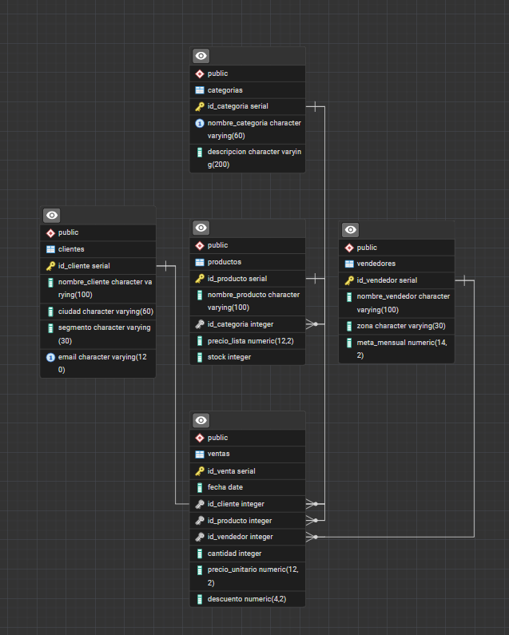

# AquaExotic Store · Gestión de Invertebrados y Plantas Acuáticas

Integrante: Carlos Andrés Rivera Cisneros
Curso: Programación Web — Proyecto Final  

Aplicación web CRUD desarrollada con **Python 3, Flask y PostgreSQL** para la gestión integral de una tienda especializada en acuariofilia, gambas ornamentales (Neocaridina y Caridina), caracoles limpiadores y plantas de aquascaping.

Permite consultar, crear, editar y eliminar registros sobre 5 tablas normalizadas en 3FN (`categorias`, `productos`, `clientes`, `vendedores` y `ventas`).

## Tecnologías utilizadas
* Backend: Python 3, Flask 3 (Blueprints), `psycopg2-binary`, `python-dotenv`
* Base de datos: PostgreSQL
* Frontend: HTML5, Jinja2 (herencia de plantillas), Bootstrap 5, CSS3 personalizado

## Estructura del proyecto

```text
crud_ventas/
├── app.py               # Punto de entrada: crea la app y registra los blueprints
├── config.py            # Lee la configuración del archivo .env
├── db.py                # Conexión a PostgreSQL y manejo de errores SQL
├── validators.py        # Validaciones de formularios en el servidor
├── routes/              # Un blueprint (CRUD) por cada una de las 5 tablas
├── templates/           # Plantillas Jinja2 con herencia desde base.html
├── static/              # Estilos CSS, Bootstrap local e imágenes de la tienda
├── database/            # Script y respaldo de la base de datos (backup.sql)
├── docs/                # Diagrama MER, diccionario de datos, 3FN y plan de pruebas
├── requirements.txt     # Dependencias del proyecto
├── .env.example         # Plantilla de variables de entorno
└── .gitignore           # Exclusión de .venv, .env y __pycache__
```

## Modelo Entidad-Relación (MER)



## Instalación y ejecución en Windows

1. Clonar o descargar el repositorio y abrir la terminal en la carpeta del proyecto:
   ```powershell
   cd crud_ventas
   ```
2. Crear y activar el entorno virtual:
   ```powershell
   python -m venv .venv
   .venv\Scripts\activate
   ```
3. Instalar las dependencias:
   ```powershell
   pip install -r requirements.txt
   ```
4. Configurar las variables de entorno duplicando `.env.example` como `.env` con las credenciales de PostgreSQL:
   ```env
   DB_HOST=localhost
   DB_PORT=5432
   DB_NAME=ventas_db
   DB_USER=postgres
   DB_PASSWORD=tu_contraseña
   ```
5. Restaurar la base de datos ejecutando el archivo `database/backup.sql` en pgAdmin 4.
6. Iniciar la aplicación:
   ```powershell
   python app.py
   ```
7. Abrir en el navegador: **http://127.0.0.1:5001**
